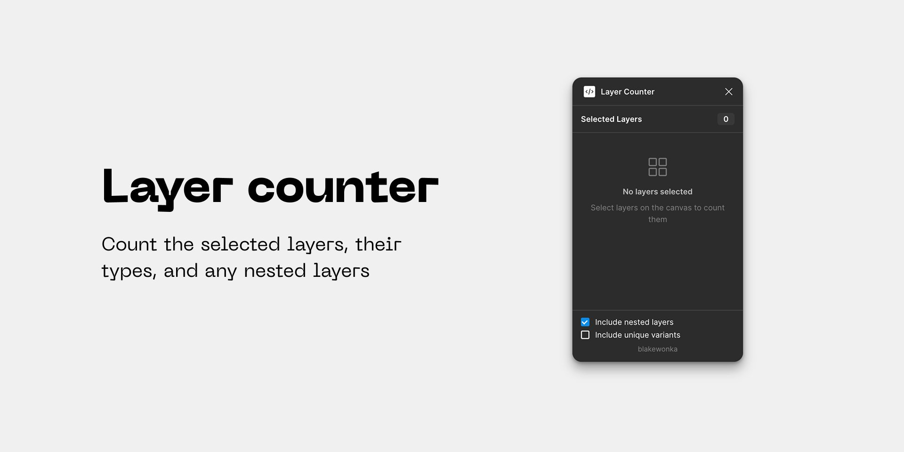

# Layer Counter

Figma and FigJam plugin.

Count selected layers, layer types, and nested layers.

The counts automatically update every time you select any layers.

With _Include nested layers_ on, every layer inside a selected frame, group, component, instance, component set, boolean operation or section is counted too, hidden layers included.

## Development

Requires Node 22.18 or newer and npm.

| Command                | What it does                                                  |
| ---------------------- | ------------------------------------------------------------- |
| `npm ci`               | Install dependencies                                          |
| `npm run dev`          | Rebuild `dist/` on every change (unminified)                  |
| `npm run build`        | Type-check, then write a minified production build to `dist/` |
| `npm test`             | Run the unit tests in `test/` (no build step needed)          |
| `npm run check`        | Type-check and run the tests                                  |
| `npm run typecheck`    | Type-check the plugin, UI and tests without building          |
| `npm run format`       | Format the source with Prettier                               |
| `npm run format:check` | Report files Prettier would change, without writing           |

To try it in Figma, open `Plugins` → `Development` → `Import plugin from manifest…` and choose `manifest.json`. Open the console with `Plugins` → `Development` → `Open console` to see errors from either side.

### Layout

```
src/
  plugin/          runs in Figma's plugin sandbox (bundled to dist/code.js)
    main.ts        UI handshake, selection events, message routing
    count.ts       counts the selection by node type
    exportCard.ts  draws the "Layer Counter" card on the canvas
    iconPaths.ts   vector paths for the card's row icons
  ui/              runs in the plugin window (bundled into dist/ui.html)
    index.html     static markup
    main.ts        fills in the counts and relays clicks to the plugin
    sort.ts        row order for the list (count desc, then type name)
    icons.ts       inline SVG icons for the rows
    styles.css     all styling; uses Figma's --figma-color-* theme variables
  shared/          code and types used by both sides
    counts.ts      TypeCounts, typeLabel, totalOf
    messages.ts    the message protocol between plugin and UI
test/              node:test unit tests, run directly against src/
build.mjs          esbuild script; inlines the UI's JS and CSS into dist/ui.html
manifest.json      Figma plugin manifest; points at dist/code.js and dist/ui.html
tsconfig*.json     one type-check project per runtime (plugin, ui, test) sharing
                   tsconfig.base.json; tsconfig.json only ties them together for editors
```

The UI has no framework: `dist/ui.html` is a single self-contained file of about 11 KB, and the plugin loads nothing from the network.
